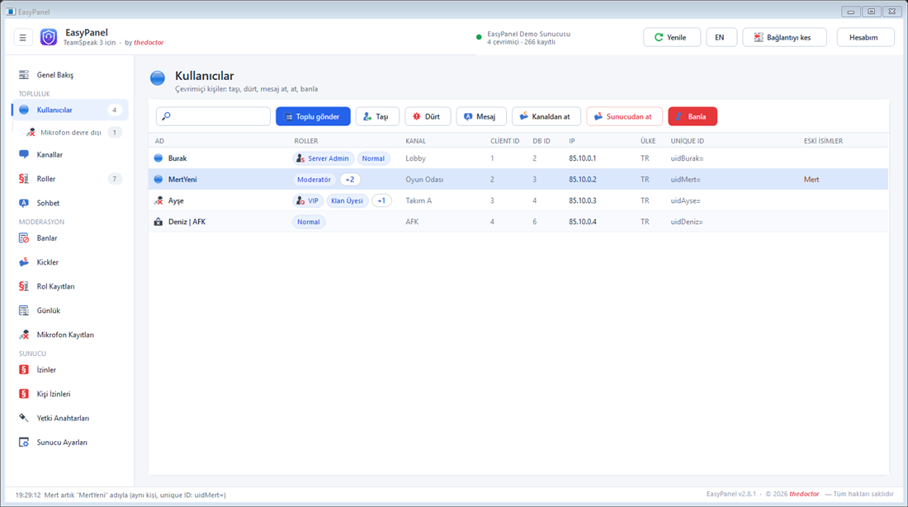
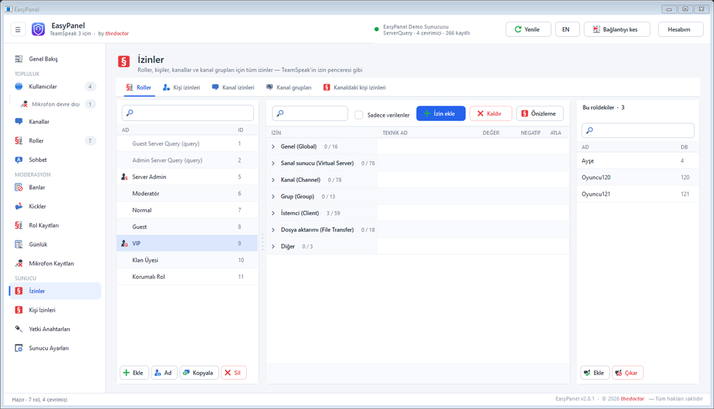
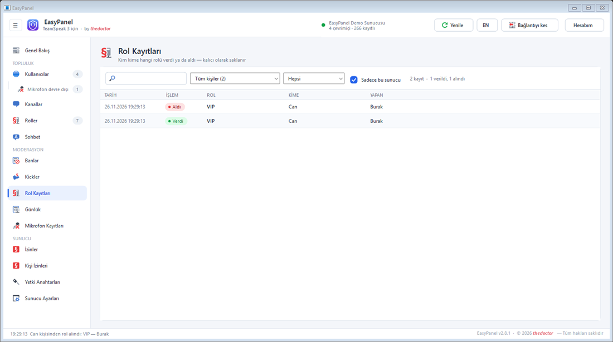
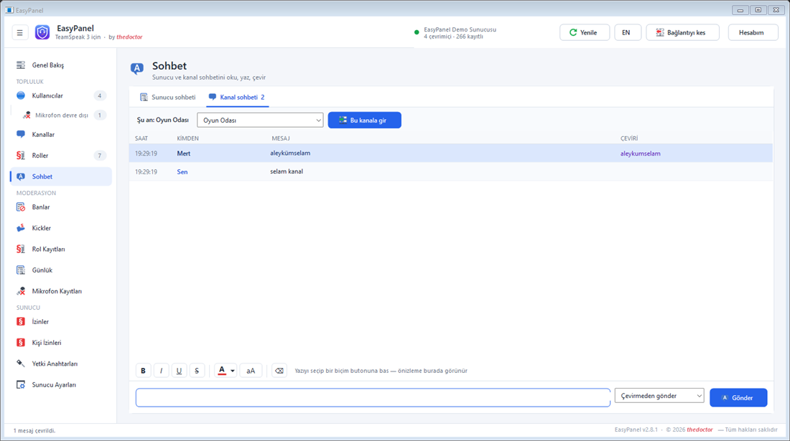
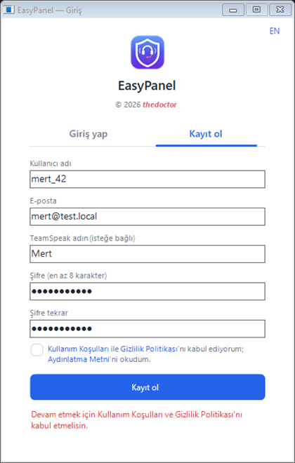

  

<h1 align="center">EasyPanel</h1>

  TeamSpeak 3 sunucuları için sade Windows yönetim paneli. 
  Rol verme, kanal düzenleme, izin yönetimi ve moderasyon kayıtları tek pencerede.

  <a href="https://easypanel.tr"><b>easypanel.tr</b></a>
  &nbsp;·&nbsp;
  <a href="https://easypanel.tr/hesap/">Hesabım</a>
  &nbsp;·&nbsp;
  <a href="#ozellikler">Özellikler</a>
  &nbsp;·&nbsp;
  <a href="#ekran-goruntuleri">Ekran görüntüleri</a>
  &nbsp;·&nbsp;
  <a href="#guvenlik">Güvenlik</a>
  &nbsp;·&nbsp;
  <a href="#erisim">Erişim ve destek</a>

  Windows 10 / 11 · Türkçe / English · Kurulumsuz tek dosya · Kapalı Beta

  

> EasyPanel şu an kapalı beta aşamasındadır. Program tek `.exe` dosyası olarak çalışır, kurulum gerektirmez ve yalnızca abonelere dağıtılır.

---

## Neden EasyPanel?

- **Tamamen Türkçe arayüz:** 265'ten fazla TeamSpeak izni açıklamalarıyla birlikte Türkçe. Tek tıkla İngilizceye geçilebilir.
- **Kendi yetkinle çalışır:** Yalnızca yetkinin yettiği rolleri ve işlemleri gösterir; yetkin değiştiğinde listeler otomatik güncellenir.
- **Onay olmadan işlem yok:** Toplu işlemlerde önce ne yapılacağı özetlenir, onay verilmeden başlamaz.
- **Verilerin bilgisayarında kalır:** API anahtarı, ServerQuery şifresi ve sunucuna ait tüm veriler yalnızca kendi bilgisayarında tutulur.
- **Sunucuyu yormaz:** Komutları aralıklarla ve birleştirerek gönderir; flood veya paket hatası yüzünden sunucudan düşmezsin.

## Özellikler

<table>
<tr>
<td width="50%" valign="top">

### Roller ve kullanıcılar
- Tek tek veya toplu rol verme / alma, rol baloncuğundan tek tıkla rol kaldırma
- Birden fazla role göre **VE / VEYA** filtreleme
- Client ID, DB ID, IP, Unique ID ve **eski isim geçmişi** aynı tabloda
- Taşıma, dürtme, özel mesaj, kanaldan / sunucudan atma, banlama, Talk Power
- Herkesi tek komutla kanala çekme, hızlı veya güvenli modda toplu dürtme / mesaj
- Mikrofonunu devre dışı bırakanları anlık listeleme

### Kanallar
- Kanal ağacı ve tam ayar düzenleyici (ad, konu, açıklama, şifre, kodek, kalite, Talk Power)
- Kanal oluşturma, alt kanal açma, silme, sıralama ve taşıma
- Tek tek veya toplu kanal simgesi atama
- **Toplu ad biçimi:** Tüm kanal adlarını tek seferde biçimlendirme ve geri alma

</td>
<td width="50%" valign="top">

### İzinler ve moderasyon
- TeamSpeak izin penceresinin tamamı: sunucu grupları, kişi izinleri, kanal izinleri ve kanal grupları
- **Güç önizleme:** Seçilen güç değerinin hangi rol veya kanallara yettiğini anlık görme
- Ban yönetimi, yetki anahtarları ve sunucu ayarları

### Kayıtlar ve sohbet
- **Rol kayıtları:** Hangi rolü kimin verip aldığının kalıcı kaydı
- **Kick kayıtları:** Sunucudan ve kanaldan atılmalar (kim, kimi, neden)
- **Mikrofon kayıtları:** Mikrofonunu devre dışı bırakanların zaman ve süre geçmişi
- Günlük olay kayıtları (otomatik dosyaya yazılır)
- **Sohbet:** Sunucu ve kanal sohbeti, BBCode biçim çubuğu ve tek tıkla 8 dile çeviri

</td>
</tr>
</table>

## Ekran görüntüleri

<table>
<tr>
<td width="50%"> <b>Roller</b> — yetkiye göre listelenen roller, toplu verme ve alma</td>
<td width="50%"> <b>Kullanıcılar</b> — ID, IP, Unique ID ve eski isim geçmişi</td>
</tr>
<tr>
<td> <b>İzinler</b> — TeamSpeak izin penceresinin Türkçe hâli</td>
<td> <b>Kanallar</b> — kanal ağacı ve ayrıntılı ayar düzenleyici</td>
</tr>
<tr>
<td> <b>Rol kayıtları</b> — hangi rolü kimin verip aldığının kaydı</td>
<td> <b>Sohbet</b> — sunucu / kanal sohbeti, biçim çubuğu ve çeviri</td>
</tr>
<tr>
<td> <b>Güç önizleme</b> — seçilen güçle hangi rollere yetki yetiyor</td>
<td> <b>Toplu ad biçimi</b> — tüm kanal adlarını tek seferde düzenleme</td>
</tr>
</table>

  
  &nbsp;&nbsp;
  
   Giriş / kayıt ekranı ve Hesabım penceresi

## Güvenlik ve veri gizliliği

| Bilgisayarında kalanlar (dışarı gönderilmez) | EasyPanel hesabında tutulanlar (yalnızca hesap) |
|---|---|
| ClientQuery API anahtarı ve ServerQuery şifresi (Windows şifrelemesiyle saklanır) | Kullanıcı adı, e-posta ve abonelik tarihleri |
| Sunucudaki kullanıcılar, kanallar, roller, izinler ve sohbetler | Tek bilgisayar kilidi için geri döndürülemez cihaz özeti |
| Günlük, rol, kick ve mikrofon kayıt dosyaları | Program güncellemeleri ve onay verirsen gönderilen hata raporları |

- Şifreler geri çözülemez biçimde (hash) saklanır.
- Her abonelik tek bilgisayara bağlıdır; bilgisayar değiştirdiğinde destekten cihaz sıfırlaması isteyebilirsin.
- Hesabını istediğin zaman doğrudan program içinden silebilirsin.

## Gereksinimler

| Bileşen | Gereksinim |
|---|---|
| İşletim sistemi | Windows 10 / 11 |
| Çalışma ortamı | .NET Framework 4.x (Windows'ta hazır gelir) |
| TeamSpeak bağlantısı | Açık TeamSpeak 3 istemcisi (ClientQuery) veya ServerQuery erişimi |
| Hesap | EasyPanel hesabı ve aktif abonelik |

## Erişim ve destek

- **Web sitesi:** [easypanel.tr](https://easypanel.tr)
- **Hesap ve destek talebi:** [easypanel.tr/hesap](https://easypanel.tr/hesap/)
- **Discord:** `deepeep222`

## Sık sorulanlar

<b>EasyPanel'i nasıl edinebilirim?</b>

Program şu an kapalı betada. Discord üzerinden `deepeep222` hesabına ulaşabilirsin. Aboneliğin tanımlandığında program ve tüm güncellemeler doğrudan uygulama içinden gelir.

<b>Sunucumda yetkim kısıtlıysa ne olur?</b>

Program yalnızca yetkinin yettiği işlemleri gösterir. Örneğin rol verme gücün 50 ise sadece 50 ve altı güç isteyen roller listelenir.

<b>API key ve ServerQuery şifrem güvende mi?</b>

Evet. Bu bilgiler yalnızca kendi bilgisayarında Windows şifrelemesiyle saklanır, EasyPanel sunucularına hiç gönderilmez.

<b>Beta sürüm ne anlama geliyor?</b>

Günlük kullanıma hazır ancak hâlâ yeni özellikler ekleniyor. Beklenmeyen bir hata oluşursa program istersen hata raporunu geliştiriciye göndermeni önerir.

---

  
    EasyPanel © 2026 <b><i>thedoctor</i></b> — Tüm hakları saklıdır. Kaynak kodu ve program dosyaları bu depoda yayımlanmaz. 
    EasyPanel bağımsız bir projedir; TeamSpeak Systems GmbH ile bağlantılı değildir ve onun tarafından onaylanmamıştır. "TeamSpeak", hak sahibinin tescilli markasıdır.
  

