

  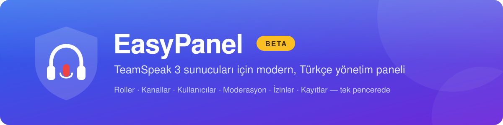

  
  
  
  

  <b>Rolleri tek tıkla ver, kanalları toplu düzenle, kim mikrofonunu kapattı gör — karmaşık menüler olmadan.</b> 
  EasyPanel şu anda <b>kapalı beta</b> aşamasındadır. İndirme bağlantısı herkese açık değildir; program yalnızca abonelere verilir.

---

  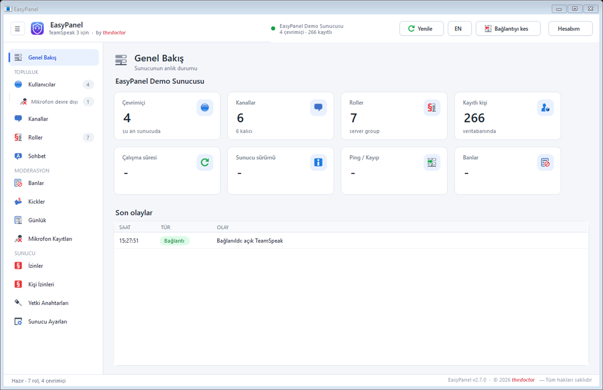

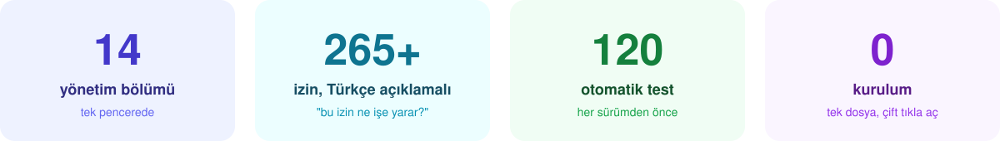

## ✨ Neden EasyPanel?

| | |
|---|---|
| 🇹🇷 **Tamamen Türkçe** | Her izin, her ayar, her buton anlaşılır Türkçe. İstersen tek tıkla İngilizce. |
| 🎯 **Yetkine göre çalışır** | Sadece verebileceğin rolleri gösterir; yetkin değişince kendiliğinden güncellenir. |
| 🛡️ **Önce onay** | Hiçbir işlem sen butona basmadan yapılmaz. Toplu işlemlerde önce özet, sonra onay. |
| 🔒 **Verin sende** | API key, ServerQuery şifresi ve sunucundaki her şey **senin bilgisayarında** kalır. |
| ⚡ **Sunucuyu yormaz** | Komutları akıllıca birleştirir; "Packet resend failed" ile sunucudan düşmezsin. |
| 🪶 **Tek dosya** | Kurulum yok. Çift tıkla, bağlan, yönet. Güncellemeler program içinden gelir. |

## 🧩 Özellikler

<table>
<tr>
<td width="50%" valign="top">

### 👥 Topluluk
- **Kullanıcılar** — taşı, dürt, özel mesaj, kanaldan / sunucudan at, banla, Talk Power ver / al
- **Toplu taşıma** — herkesi tek komutla bir kanala çek
- **Toplu dürtme / mesaj** — hızlı ya da güvenli modda
- **Mikrofon devre dışı** listesi — mikrofonunu kapatanları anında gör
- **Sohbet** — kalın, italik, renk, boyut araç çubuğu (BBCode)

### 🏷️ Roller
- Tek tek (sağ tık) ya da **toplu** rol ver / al
- Role tıkla → o role sahip olanlar; iki role tıkla → **ikisine birden** sahip olanlar
- Rol ikonları, "+N" ile kişinin tüm rolleri
- Rolü tüm üyelerinden tek seferde al

</td>
<td width="50%" valign="top">

### 📺 Kanallar
- Tam kanal düzenleyici: ad, konu, açıklama, şifre, kodek, kalite, Talk Power, tür
- Oluştur, alt kanal aç, sil, sırala, başka kanalın altına taşı
- **Toplu ad biçimi** — tüm kanal adlarını 𝐤𝐚𝐥ı𝐧, 𝑖𝑡𝑎𝑙𝑖𝑘… yap, geri al
- Kanal simgeleri (tek tek ya da toplu)

### 🛠️ Moderasyon ve sunucu
- **Banlar**, **Kickler** (kim, kimi, neden), canlı **Günlük**
- **Mikrofon kayıtları** — kim, ne zaman, ne kadar süre kapattı (kalıcı)
- **İzinler** ve **Kişi İzinleri** — 265+ iznin Türkçe açıklaması
- **Güç önizleme** — "bu güçle hangi rolleri verebilirim?"
- **Yetki anahtarları**, **Sunucu ayarları**

</td>
</tr>
</table>

## 📸 Ekran görüntüleri

<table>
<tr>
<td width="50%">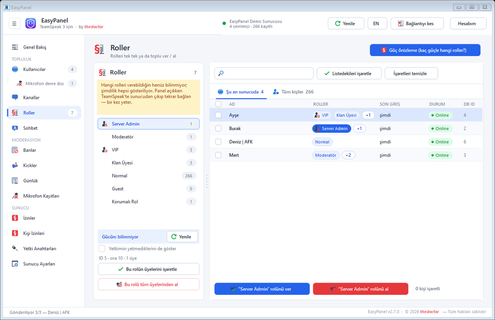 <b>Roller</b> — yetkine göre verilebilir roller, toplu ver / al</td>
<td width="50%">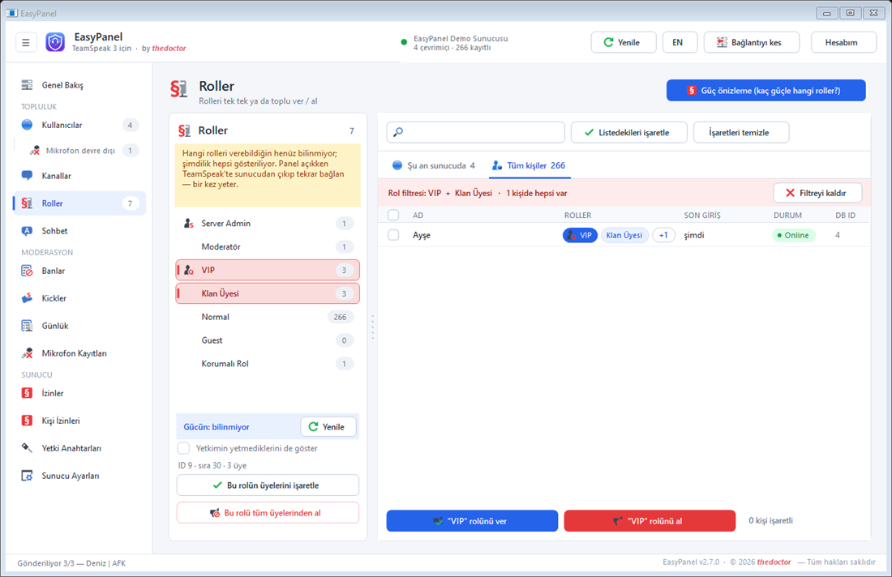 <b>Rol filtresi</b> — birden fazla role sahip olanları bul</td>
</tr>
<tr>
<td>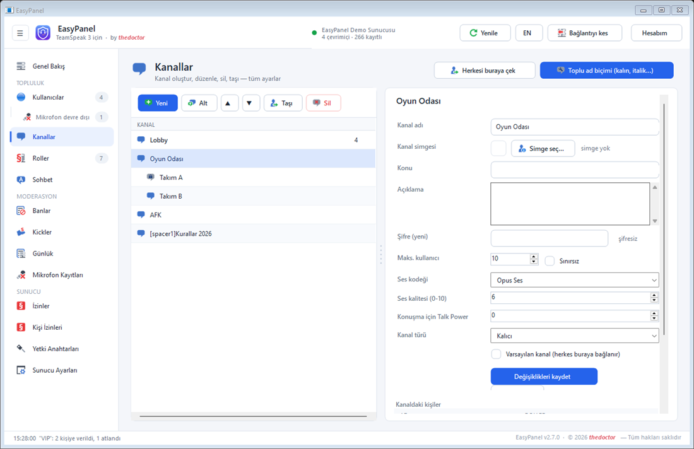 <b>Kanallar</b> — ağaç + tam ayar düzenleyici</td>
<td>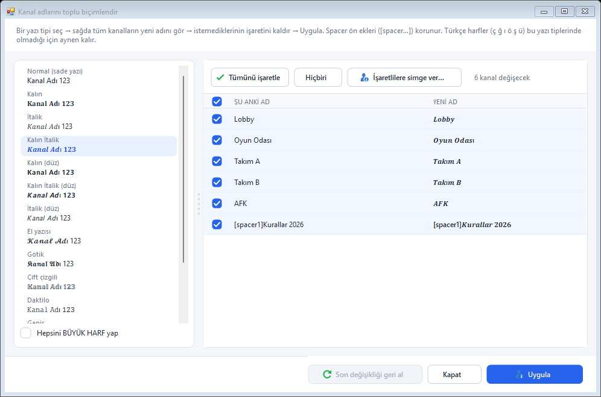 <b>Toplu ad biçimi</b> — tüm kanallara tek tıkla yazı tipi</td>
</tr>
<tr>
<td>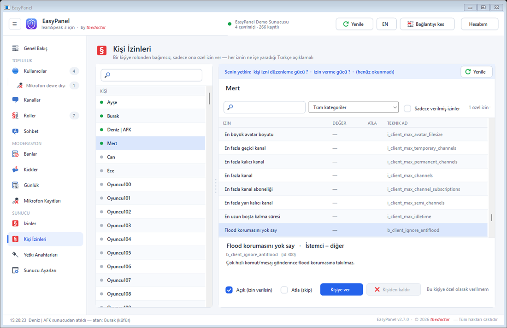 <b>Kişi İzinleri</b> — her izin Türkçe açıklamalı</td>
<td>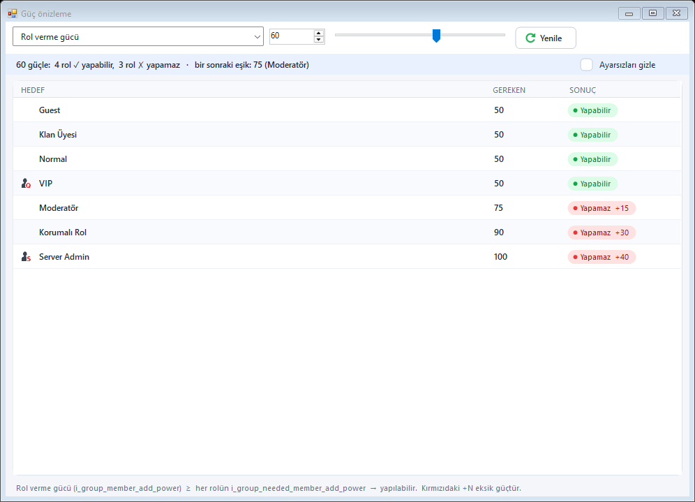 <b>Güç önizleme</b> — hangi rolü verebilirsin, kaç güç eksik</td>
</tr>
<tr>
<td>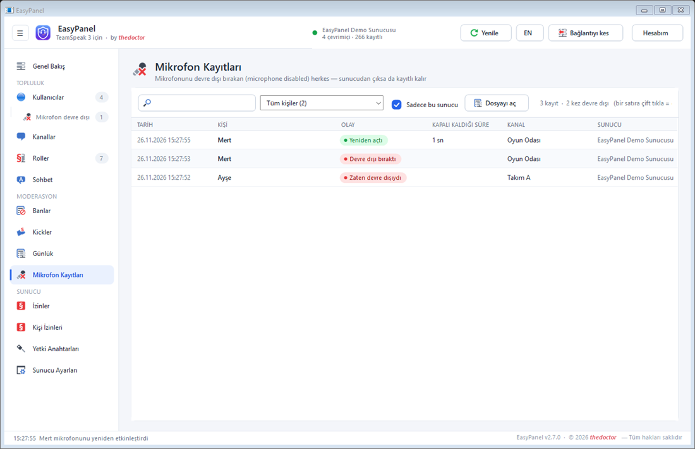 <b>Mikrofon kayıtları</b> — sen yokken de tutulur</td>
<td>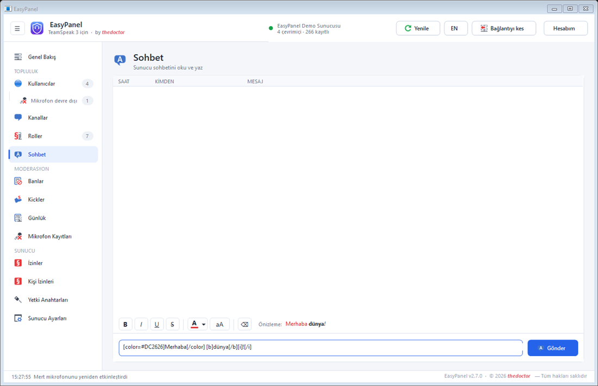 <b>Sohbet</b> — biçim araç çubuğu ve canlı önizleme</td>
</tr>
</table>

  
  &nbsp;&nbsp;
  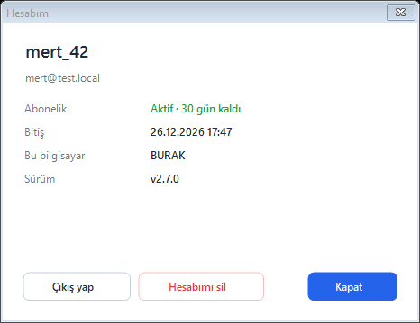
   Hesap ve abonelik: giriş / kayıt ekranı ve "Hesabım" penceresi

## 🔐 Güvenlik ve gizlilik

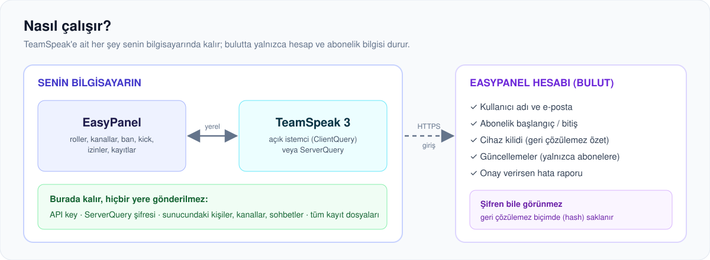

- Program sunucuna **senin yetkilerinle** bağlanır; yetkinin yetmediği bir işlemi zaten yapamaz.
- Toplu işlemler önce **ne yapılacağını gösterir**, sen onaylamadan başlamaz.
- Her abonelik **tek bilgisayarda** çalışır (cihaz kilidi). Bilgisayar değiştirirsen sıfırlatman yeterli.
- Hesabını istediğin an **program içinden silebilirsin**.

## 💻 Gereksinimler

| | |
|---|---|
| İşletim sistemi | Windows 10 / 11 |
| Çalışma ortamı | .NET Framework 4.x (Windows'ta hazır gelir) |
| Bağlantı | Açık TeamSpeak 3 istemcisi (ClientQuery eklentisi) **veya** ServerQuery erişimi |
| Hesap | EasyPanel hesabı + aktif abonelik |

## 🗺️ Yol haritası

- [x] Roller, kanallar, kullanıcılar, moderasyon, izinler
- [x] Toplu taşıma / dürtme / mesaj, toplu kanal adı biçimi
- [x] Mikrofon ve kick kayıtları (kalıcı)
- [x] Hesap, abonelik, cihaz kilidi, otomatik güncelleme
- [ ] ServerQuery ile sürekli kayıt (TeamSpeak açık olmasa da)
- [ ] Otomatik ödeme ile abonelik
- [ ] Daha fazla dil

## ❓ Sık sorulanlar

<b>Nasıl edinebilirim?</b>

EasyPanel şu anda kapalı betadır. Erişim için geliştiriciyle iletişime geç. Abonelik açıldıktan sonra program ve tüm güncellemeler program içinden gelir.

<b>Sunucumda yetkim yoksa ne olur?</b>

Program yalnızca senin yetkinin yettiği işlemleri gösterir. Örneğin rol verme gücün 50 ise sadece 50 ve altı güç isteyen rolleri verebilirsin.

<b>API key'im güvende mi?</b>

Evet. API key ve ServerQuery şifren yalnızca kendi bilgisayarında, Windows'un şifrelemesiyle saklanır; EasyPanel sunucularına hiç gönderilmez.

<b>Beta ne demek?</b>

Program günlük kullanıma hazırdır ama hâlâ geliştiriliyor: yeni özellikler ekleniyor, nadiren hatalarla karşılaşabilirsin. Hata olursa program sana "raporu göndereyim mi?" diye sorar.

---

  
    EasyPanel © 2026 <b><i>thedoctor</i></b> — Tüm hakları saklıdır. Kaynak kodu ve program dosyaları bu depoda yayımlanmaz. 
    EasyPanel bağımsız bir projedir; TeamSpeak Systems GmbH ile bağlantılı değildir ve onun tarafından onaylanmamıştır. "TeamSpeak", hak sahibinin tescilli markasıdır.
  

